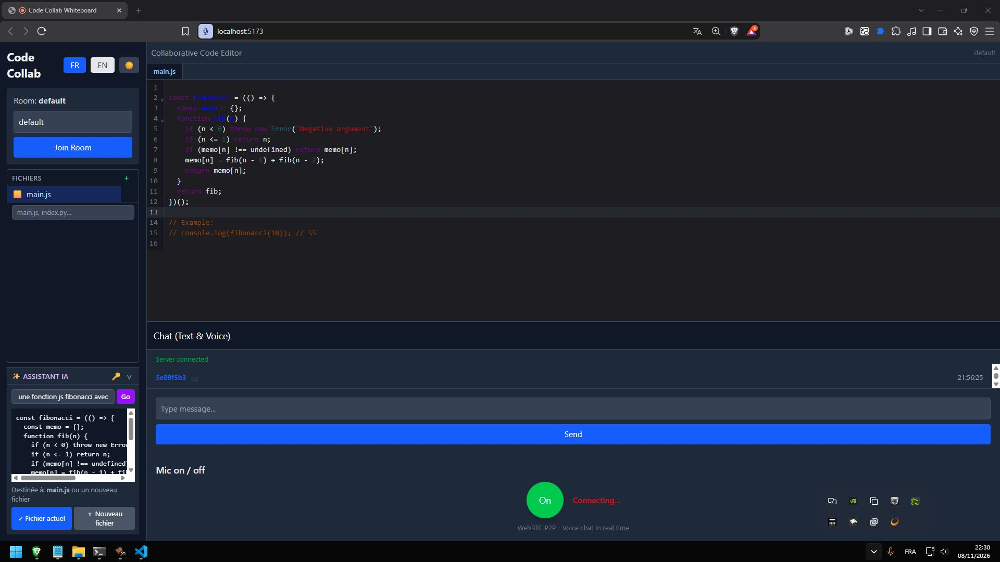

<div align="center">

# 🧑‍💻 Code Collab Whiteboard

**Éditeur de code collaboratif en temps réel — avec chat texte, chat vocal et assistant IA.**

*Collaborative real-time code editor — with text chat, voice chat and an AI assistant.*

[](https://www.rust-lang.org/)
[](https://react.dev/)
[](https://yjs.dev/)
[](https://www.typescriptlang.org/)
[]()



</div>

## ✨ Fonctionnalités

| | |
|---|---|
| ⚡ **Éditeur temps réel** | Plusieurs personnes codent dans le même fichier, curseurs et sélections colorées par participant (Yjs CRDT + CodeMirror 6) |
| 📁 **Système de fichiers partagé** | Création / suppression de fichiers synchronisée dans toute la room, arbre de fichiers + onglets |
| 💾 **Persistance double** | Sauvegarde serveur (mémoire) **et** locale (IndexedDB) → rien ne se perd, même après un redémarrage |
| 💬 **Chat texte** | Messages instantanés par room via WebSocket |
| 🎙️ **Chat vocal** | WebRTC P2P maison — aucun serveur audio tiers, voix en direct |
| 🤖 **Assistant IA** | Génération de code via [Groq](https://console.groq.com) (gratuit), insertion au curseur ou dans un nouveau fichier, **BYOK** (ta clé reste dans ton navigateur) |
| 🌓 **Dark mode** | Thème sombre persistant |
| 🇫🇷🇬🇧 **Bilingue** | Interface FR/EN |
| 🕶️ **Anonyme** | Aucun compte requis — profil personnalisé optionnel |

## 🏗️ Architecture

```
┌─────────────────────┐        ┌──────────────────────┐
│  Frontend React+Vite │        │  Backend Rust (Axum)  │
│  CodeMirror 6        │──────▶│  :3000                │
│  y-codemirror.next   │        │  ├─ /ws        chat   │
│                      │        │  ├─ /api/ai    proxy  │
│  y-websocket-client  │──────▶│  └─ /api/rooms rooms  │
│  y-indexeddb         │        │                       │
└──────────┬───────────┘        └───────────────────────┘
           │
           ▼
   ┌──────────────────┐
   │  Serveur Yjs      │
   │  (y-websocket)    │  ← sync CRDT des documents
   │  :1234            │
   └──────────────────┘
```

- **CRDT Yjs** : fusion automatique sans conflit, fonctionne même hors-ligne (re-sync à la reconnexion)
- **Backend Rust** : chat, gestion des rooms, proxy IA (clé serveur *ou* BYOK) — zéro clé exposée côté client
- **Groq** : API compatible OpenAI, modèles type `gpt-oss-120b` — remplaçable en 2 lignes via `.env`

## 🚀 Démarrage rapide

### Prérequis
- [Rust](https://rustup.rs/) 🦀
- [Node.js](https://nodejs.org/) ≥ 18

### 1. Backend (Rust)

```bash
cd collab-whiteboard-backend

# Ta clé IA gratuite — https://console.groq.com
echo "AI_API_KEY=gsk_..."   >  .env
echo "AI_API_BASE=https://api.groq.com/openai/v1" >> .env
echo "AI_MODEL=openai/gpt-oss-120b"               >> .env

cargo run   # → http://localhost:3000
```

### 2. Serveur de sync Yjs

```bash
npx y-websocket   # → ws://localhost:1234
```

### 3. Frontend

```bash
cd collab-whiteboard-frontend
npm install
npm run dev   # → http://localhost:5173
```

Ouvre **deux onglets** (ou deux navigateurs) sur la même room → les edits, le chat et les fichiers se synchronisent en direct. 🎉

## 📁 Structure

```
├── collab-whiteboard-backend/     # 🦀 API Rust (Axum)
│   └── src/
│       ├── main.rs                # routes + démarrage
│       ├── server.rs              # WebSocket chat + rooms
│       ├── ai.rs                  # proxy IA (Groq / OpenAI / GLM)
│       ├── app_state.rs · rooms.rs · yjs.rs
└── collab-whiteboard-frontend/    # ⚛️ UI React + TypeScript
    └── src/
        ├── App.tsx                # layout complet
        ├── hooks/useYRoom.ts      # Y.Doc + WebSocket + IndexedDB
        └── components/            # Editor · FileTree · TabsBar · ChatText · ChatVoice · AIHelper · LanguageToggle
```

## 🔧 Configuration

Tout se règle via le `.env` du backend — **change de provider IA en 2 lignes**, sans recompiler :

| Variable | Exemple | Description |
|----------|---------|-------------|
| `AI_API_KEY` | `gsk_...` | Clé par défaut du serveur |
| `AI_API_BASE` | `https://api.groq.com/openai/v1` | Endpoint compatible OpenAI |
| `AI_MODEL` | `openai/gpt-oss-120b` | Modèle utilisé |

Les utilisateurs peuvent aussi fournir **leur propre clé** (bouton 🔑 de l'assistant) : stockée uniquement dans leur navigateur, transmise au backend via l'en-tête `x-ai-key`.

## 🗺️ Roadmap

- [ ] Déploiement en ligne (GitHub Pages + serveur public)
- [ ] Protocole y-sync intégré au backend Rust (un seul binaire)
- [ ] Chat vocal WebP2P complet entre participants
- [ ] Profils optionnels (pseudo + emoji)
- [ ] Coloration syntaxique par langage

## 📄 Licence

MIT — libre à toi de l'héberger, le modifier, le partager.

---

<div align="center">

Fait avec 🦀 + ⚛️ + ❤️ par [nyxover](https://github.com/nyxover)

</div>
